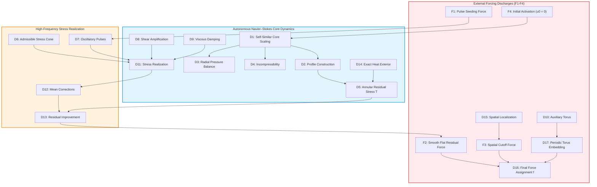

# NS-EXT-OPENAI-001 — PROOF DEPENDENCY GRAPH AND MODULAR DECOMPOSITION

**Programme**: `EXTERNAL_ASSIMILATION_AND_TRANSFER`  
**Target Source**: OpenAI, *Finite time blowup for Navier–Stokes* (165 pp., 2026)  
**Mathematical Objective**: Map all 17 structural dependencies and classify their relation to external forcing and transferability to unforced Statement B.

---

## 1. Modular Dependency Classification Table

| # | Dependency Component | Mathematical Role & Equation | Structural Class | Forcing Dependence | Transferability to $f=0$ Target |
| :- | :--- | :--- | :--- | :--- | :--- |
| **D1** | Concentrating Self-Similar Core | $\ell_r \asymp \tau^{1/2}$, $\ell_z \asymp \tau^{1/2-h}$, $u_\theta, u_z \asymp \tau^{-1/2-h}$ | `LOAD_BEARING` | `FORCE_INDEPENDENT` | **RETAINED**: Fundamental singular kinematic template. |
| **D2** | Profile Construction | Solution of ODEs for core profile $(U_r, U_\theta, U_z)$ | `LOAD_BEARING` | `FORCE_INDEPENDENT` | **RETAINED**: Autonomous nonlinear/viscous balance. |
| **D3** | Radial Pressure Balance | $\partial_r p = \frac{u_\theta^2}{r}$, centripetal acceleration | `LOAD_BEARING` | `FORCE_INDEPENDENT` | **RETAINED**: Exact Poisson momentum balance. |
| **D4** | Incompressibility Constraint | $\partial_r(r u_r) + \partial_z(r u_z) = 0$ (axisymmetric) | `LOAD_BEARING` | `FORCE_INDEPENDENT` | **RETAINED**: Incompressible kinematic condition. |
| **D5** | Annular Residual Stress $T$ | $R(u, p)$ generated by core-to-exterior mismatch | `LOAD_BEARING` | `FORCE_INDEPENDENT` | **CRITICAL**: The momentum deficit requiring cancellation. |
| **D6** | Admissible Stress Cone | Cone $\mathcal{K} \subset \operatorname{Sym}^+(2)$ of realizable Reynolds stresses | `LOAD_BEARING` | `FORCE_INDEPENDENT` | **RETAINED**: Geometric convex realization framework. |
| **D7** | Oscillatory Pulse Construction | High-frequency wave packets localized in $(r, z, t)$ | `LOAD_BEARING` | `FORCE_DEPENDENT` | **OBSTRUCTED (F1)**: Requires pulse initiation/seeding. |
| **D8** | Shear Amplification | Pulse growth via background gradient $\nabla u$ | `LOAD_BEARING` | `FORCE_INDEPENDENT` | **RETAINED**: Autonomous physical amplification mechanism. |
| **D9** | Viscous Pulse Damping | Dissipative cutoff $\exp(-\nu \int |k(t)|^2 dt)$ | `LOAD_BEARING` | `FORCE_INDEPENDENT` | **OBSTRUCTED**: Annihilates preloaded pulses if not timed. |
| **D10** | Auxiliary Torus Formulation | Periodic spatial coordinate rescaling | `TECHNICAL_LOCALIZATION` | `FORCE_INDEPENDENT` | **SIMPLIFIED**: Direct $\mathbb{T}^3$ geometry replaces auxiliary torus. |
| **D11** | Oscillatory Stress Realization | $\langle w \otimes w \rangle \approx T$ via two wave families $v_1, v_2$ | `LOAD_BEARING` | `FORCE_DEPENDENT` | **PARTIAL**: Relies on driven wave amplitudes. |
| **D12** | Mean Flow Corrections | Corrections to background $U$ to cancel back-reaction | `LOAD_BEARING` | `FORCE_INDEPENDENT` | **RETAINED**: Perturbative asymptotic expansion. |
| **D13** | Residual-Improvement Iteration | Asymptotic cycle achieving $R(u, p) = \mathcal{O}(q^N)$ | `LOAD_BEARING` | `FORCE_DEPENDENT` | **OBSTRUCTED (F2)**: Produces flat $R \neq 0$ instead of $0$. |
| **D14** | Exact Heat Exterior | Azimuthal exterior solving $\partial_t u_\theta = \nu \Delta_r u_\theta$ | `LOAD_BEARING` | `FORCE_INDEPENDENT` | **RETAINED**: Autonomous exact Navier–Stokes solution. |
| **D15** | Spatial Localization Cutoff | Smooth spatial truncation $\chi(x)$ to compact support | `TECHNICAL_LOCALIZATION` | `FORCE_DEPENDENT` | **POTENTIALLY REMOVABLE (F3)** on periodic $\mathbb{T}^3$. |
| **D16** | Smooth Force Extension | Assignment $f \equiv R(u, p) \in C_c^\infty$ | `TECHNICAL_LOCALIZATION` | `FORCE_DEPENDENT` | **PROHIBITED FOR STATEMENT B**: Must achieve $f \equiv 0$. |
| **D17** | Torus Embedding | Periodic extension from fundamental cell to $\mathbb{T}^3$ | `TECHNICAL_LOCALIZATION` | `FORCE_INDEPENDENT` | **RETAINED**: Direct periodic compatibility. |

---

## 2. Dependency Architecture Graph

---

## 3. Separation of Autonomous Dynamics from Driven Mechanics

### 3.1 What is Genuine Navier–Stokes Physics (Self-Sustaining)
1. **The Core Balance (D1–D4)**: The spin-up of $u_\theta$ under radial inflow, balanced by radial pressure gradient $\partial_r p = u_\theta^2 / r$ and axial jet ejection $u_z$, is an exact, unforced solution to the Navier–Stokes equations in the singular core.
2. **Shear-Driven Wave Growth (D8)**: The amplification of oscillatory waves by background velocity shear is a physical hydrodynamic instability (Kelvin–Helmholtz / Orr mechanism).
3. **Heat Exterior (D14)**: The exterior flow solves the unforced linear diffusion equation exactly, with zero momentum residual.

### 3.2 What is Artificial / Forcing-Dependent (The Obstacles)
1. **Pulse Seeding (D7 / F1)**: In a real fluid, waves cannot suddenly appear out of vacuum at an exact frequency and phase; OpenAI introduces an exponentially tiny body force $f_{\text{seed}} \sim e^{-1/\tau}$ to ignite each generation of waves.
2. **Residual Flatness vs Exact Zero (D13 / F2)**: The iterative expansion matches polynomials in $\tau$ and $q$, leaving a remainder that is $C^\infty$ flat ($\lim_{\tau \to 0} \tau^{-N} R = 0$ for all $N$), but **not zero**. Setting $f = R$ conceals the failure of the asymptotic series to sum to the exact solution.
3. **Zero Initial Data (F4)**: Starting at $u_0 = 0$ requires an external force to put any energy into the system.
