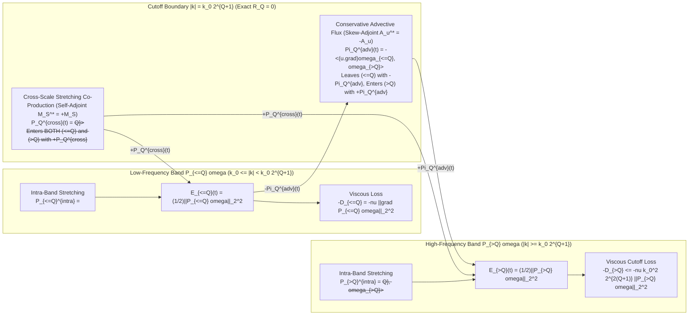
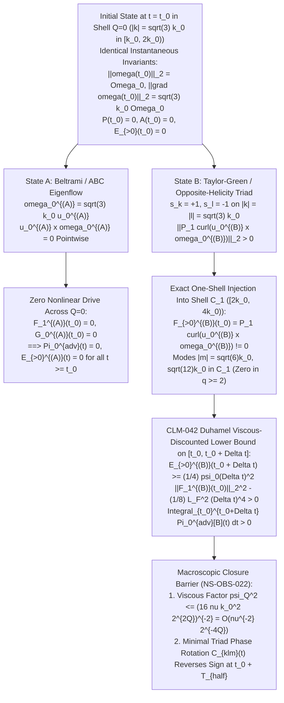
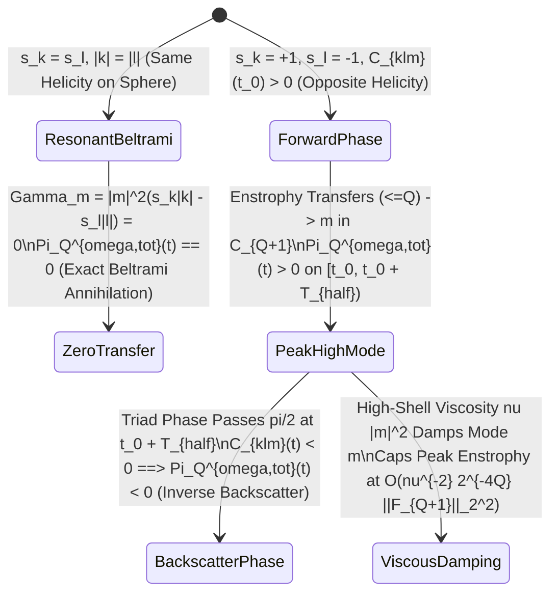

# NS-NONLINEAR-SELF-FOCUS-002: Visual Research Companion — Dyadic Flux, Operator Split, and State-Distinguishing Dynamics

**Milestone:** `NS-NONLINEAR-SELF-FOCUS-002`  
**Parent Milestone:** `NS-NONLINEAR-SELF-FOCUS-001-R1`  
**Active Governance:** `UNIVERSAL_GOVERNANCE_MINIMAL_v4.0.3`  
**Mathematical Authority:** `Mathematical Research Constitution v1.0.1`  

---

## 1. Exact Low/High Enstrophy Balance & Skew-Adjoint vs. Self-Adjoint Operator Split

---

## 2. Exact One-Shell Bandwidth Step and State-Distinguishing Branching (`CLM-042`)

---

## 3. Minimal Triad Helicity & Phase-Reversal Cycle (`NEG-EV-049`)

