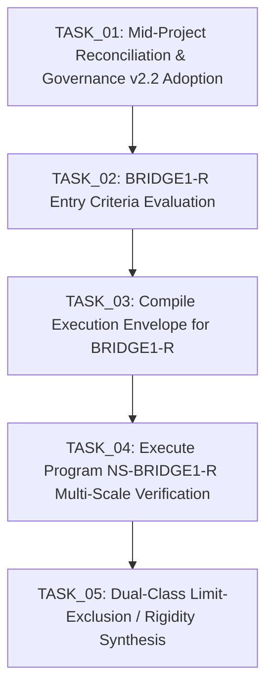

# TASK GRAPH: OPERATIONAL EXECUTION DEPENDENCIES

```
================================================================================
ADOPTION ID:                  NS_GOVERNANCE_V2_2_ADOPTION_001
RECONCILIATION DATE:          2026-08-19
================================================================================
```

---



---

## 1. Task Definitions

1. **TASK_01: Mid-Project Governance v2.2 Adoption & Reconciliation** (`COMPLETED`):
   - Adopt 4-level hierarchy, reconstruct lineage table, separate project state from scientific state.
2. **TASK_02: BRIDGE1-R Entry Criteria Evaluation** (`ACTIVE`):
   - Verify whether core morphology, critical $L^3$ mass tightness, and scale-persistent cone confinement remain the highest-information unresolved scientific questions.
3. **TASK_03: Compile Execution Envelope for BRIDGE1-R** (`PENDING`):
   - Compile narrow v2.2 `TASK_EXECUTION_ENVELOPE` with exact equations, permitted files, and test contracts.
4. **TASK_04: Execute Program NS-BRIDGE1-R** (`QUEUED`):
   - Execute cross-resolution multi-scale verification on cylinders $Q_R$.
5. **TASK_05: Dual-Class Limit-Exclusion Synthesis** (`QUEUED`):
   - Synthesize dual-class (Townsend + Burgers) rigidity bridge.
